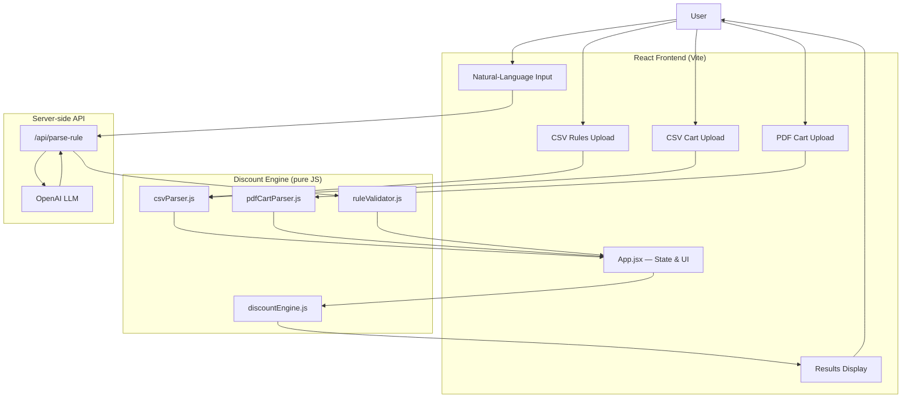
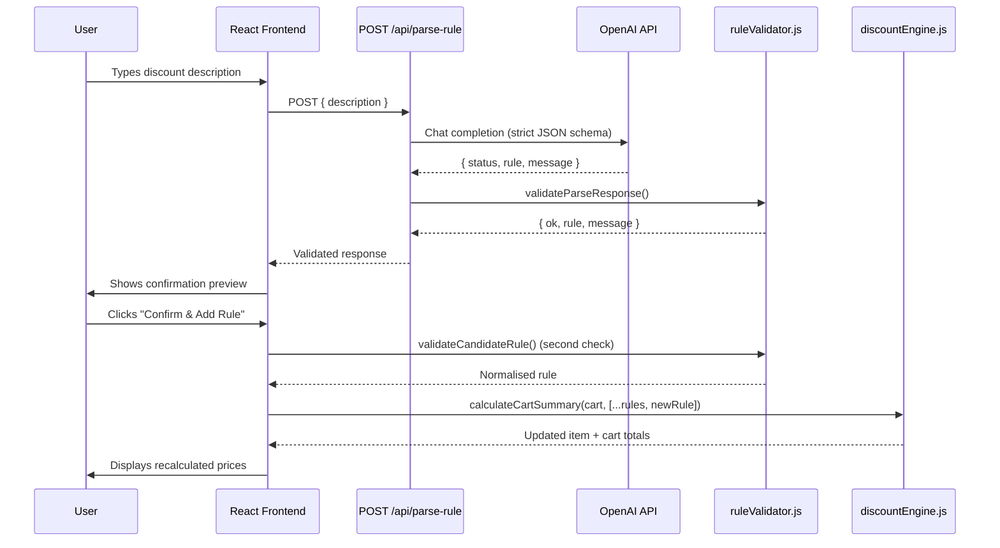
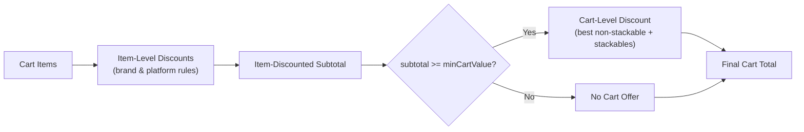

# Architecture — Opptra Discount Engine

## High-Level Overview

The application is a client-side React SPA with one server-side API endpoint for LLM integration. All discount logic lives in pure JavaScript modules with no UI dependency.



## Natural-Language Rule Flow



## Cart Processing Sequence



## Module Responsibilities

| Module | Responsibility |
|---|---|
| `src/engine/discountEngine.js` | Pure discount calculation: item-level and cart-level. No UI, no side effects. |
| `src/engine/csvParser.js` | Converts CSV text to typed `DiscountRule` and `CartItem` objects via PapaParse. |
| `src/engine/pdfCartParser.js` | Extracts cart items from text-based PDFs using PDF.js coordinate grouping. |
| `src/engine/ruleValidator.js` | Independent validation of candidate rules (from LLM or any source). |
| `server/parseRule.js` | Server-side LLM handler: system prompt, OpenAI API call, response validation. |
| `api/parse-rule.js` | Vercel serverless function wrapper for `server/parseRule.js`. |
| `src/App.jsx` | Application state, event handlers, and layout composition. |
| `src/components/*.jsx` | Presentational components: uploaders, tables, previews, summaries. |
| `src/formatMoney.js` | Rupee formatting utility. |

## Data Flow Boundaries

```
CSV text ──→ csvParser.js ──→ DiscountRule[] / CartItem[]
PDF file ──→ pdfCartParser.js ──→ CartItem[]
NL text  ──→ /api/parse-rule ──→ LLM ──→ ruleValidator.js ──→ DiscountRule

DiscountRule[] + CartItem[] ──→ discountEngine.js ──→ CartSummary
```

Every input path produces the same domain objects. The discount engine is unaware of where data originated — CSV, PDF, or LLM. Adding another input format requires only a new parser that outputs `DiscountRule` or `CartItem` objects.

## Technology Stack

| Layer | Technology |
|---|---|
| Frontend framework | React 18 |
| Build tool | Vite 5 |
| Language | JavaScript (ES modules) |
| CSV parsing | PapaParse 5 |
| PDF extraction | pdfjs-dist 4 |
| LLM provider | OpenAI API (gpt-4o-mini) |
| Serverless runtime | Vercel Functions |
| Testing | Node.js built-in test runner |
